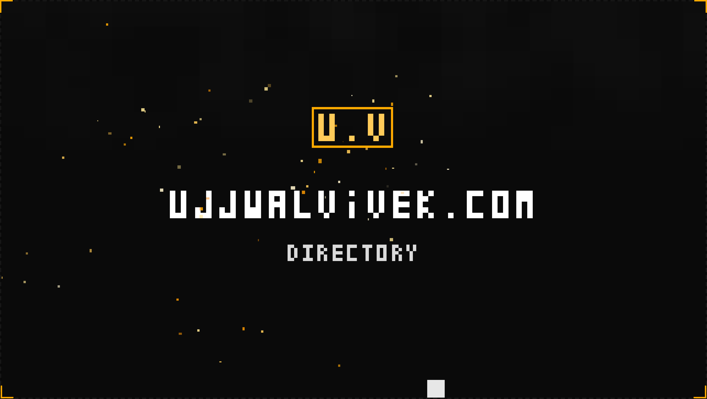
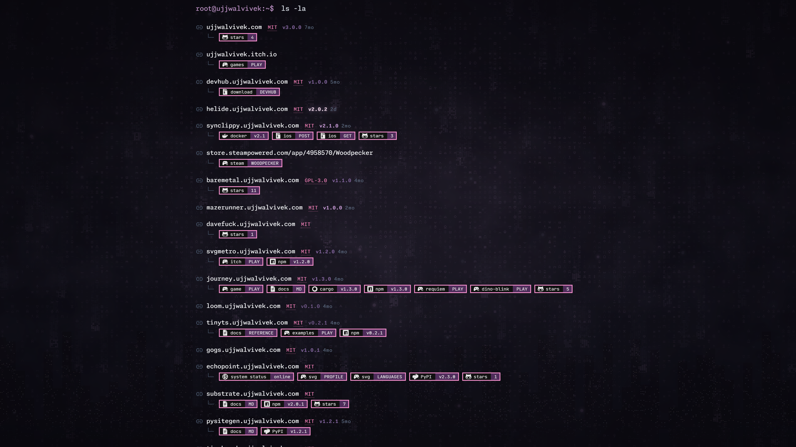
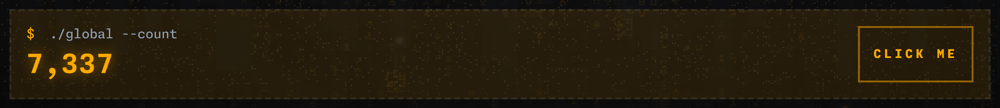
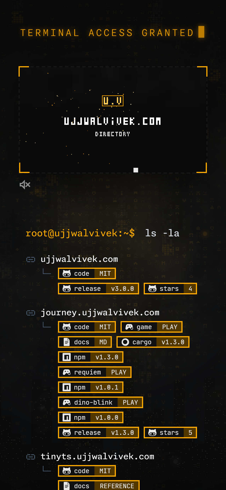
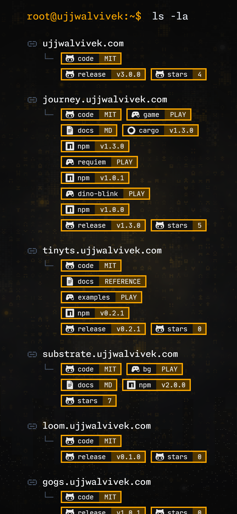

# root.ujjwalvivek.com



Honestly, a "**Link**"tree, but nicer. Website uses `Zola` under the hood, depends on the `journey` stack and `substrate` for a dystopian setting, all wrapped with a vanilla css. All audio is synthesized and goes through an AudioWorklet, with a ScriptProcessor fallback (iOS, old browsers).


## Build and run

```sh
cd game
wasm-pack build --target web --out-dir ../public/game
cd ..
zola serve --interface [IP_ADDRESS] # 0.0.0.0 --port 1111
```




## Global Clicker



## Acknowledgement

- [Journey Engine](https://crates.io/crates/journey-engine)
- [Resonance](https://crates.io/crates/journey-sound)
- [Cadence](https://crates.io/crates/journey-sequencer)
- [Substrate](https://www.npmjs.com/package/@ujjwalvivek/substrate)
- [Echopoint](https://echopoint.ujjwalvivek.com)
- [Zola](https://github.com/getzola/zola)

## Phone

 

## License

This repository is licensed with the [MIT LICENSE](License).
