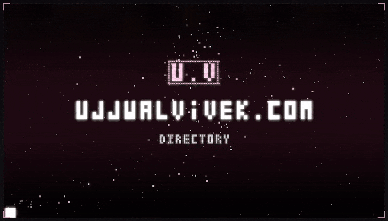
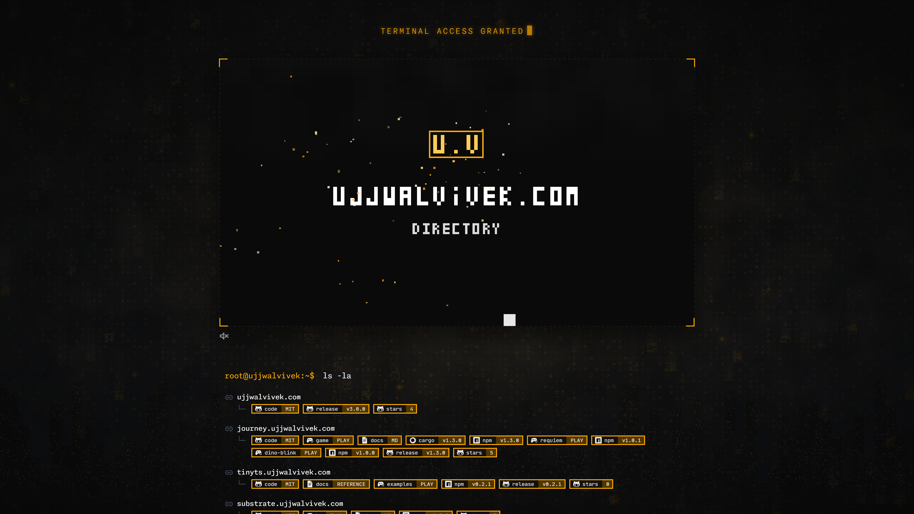
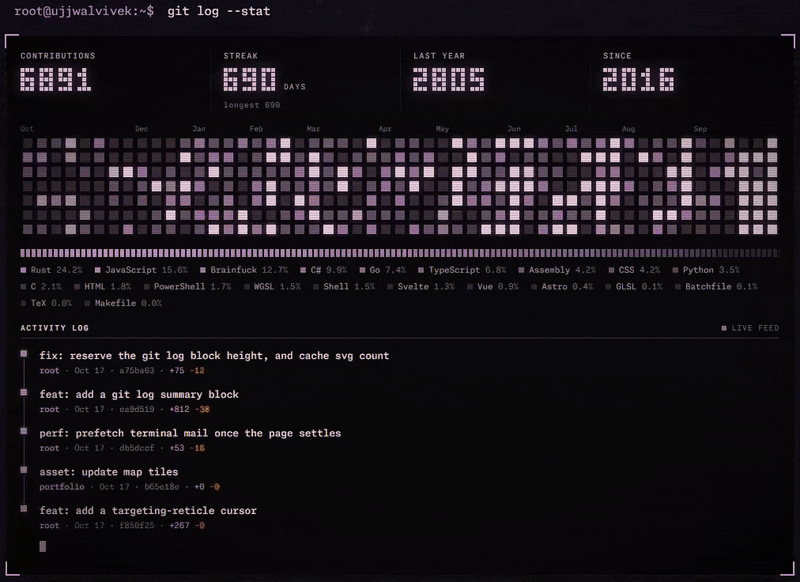
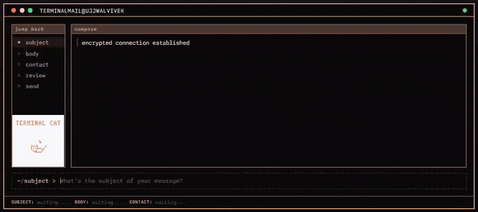
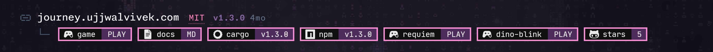
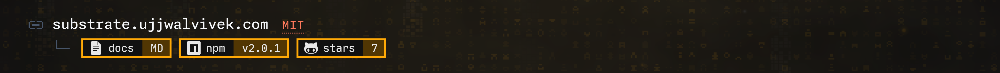
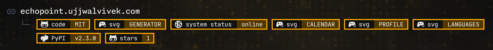
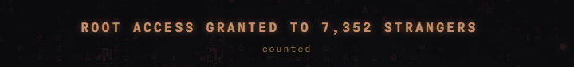

# root.ujjwalvivek.com

<!-- releasegen:demo:start -->

<!-- releasegen:demo:end -->

Honestly, a "**Link**"tree, but nicer. Website uses `Zola` under the hood, depends on the `journey` stack and `substrate` for a dystopian setting, all wrapped with a vanilla css. All audio is synthesized and goes through an AudioWorklet, with a ScriptProcessor fallback (iOS, old browsers).



## Git log

Drawn from the echopoint data, so it takes the page colours.



## Mail Me



## Build and run

```sh
cd game
wasm-pack build --target web --out-name game --out-dir ../static/game
cd ..
zola serve --interface [IP_ADDRESS] # 0.0.0.0 --port 1111
```

## Acknowledgements







## License



This repository is licensed with the [MIT LICENSE](License).
